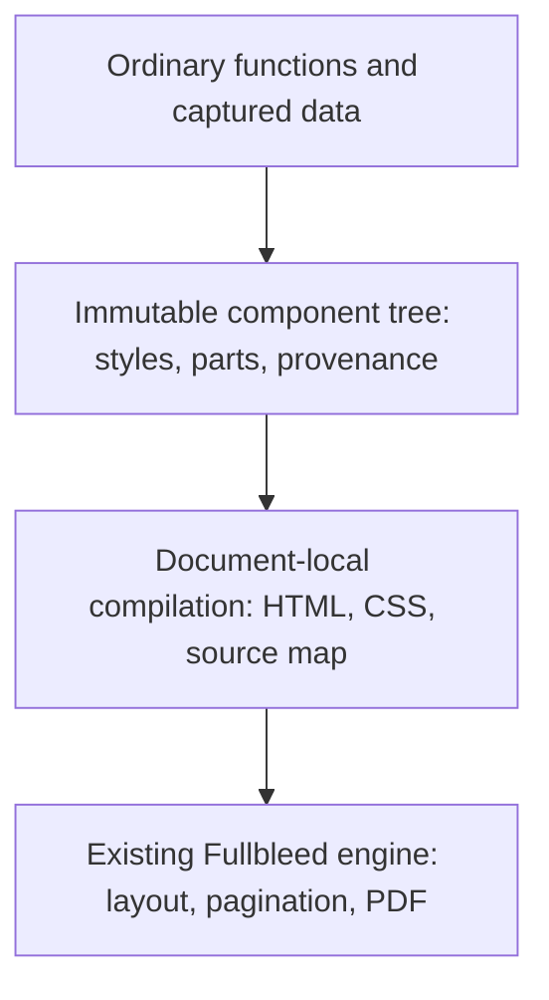

# Component authoring: implementation review

> Current release status, reviewed 2026-10-20: the component alpha is merged into
> `master` and published as **2.6.0a11**. The stable package is **2.5.34**.
> [Read the current stabilization decision and remaining gates](https://docs.fullbleed.dev/guides/component-status/).
> The dated implementation observations below retain their original scope.

Status: working proposal with an experimental Python preview, reviewed
2026-10-16. The preview is available separately on GitHub; it is not the stable
PyPI API or a promise of cross-language parity. The stable authoring guide remains
[component-authoring.md](component-authoring.md).

Start with the [next-iteration decision brief](component-authoring-next-iteration.md)
for the recommended public mental model, newly observed consistency gaps, and
prioritized work. The material below retains the detailed implementation history
and qualification boundaries.

## Assessment

The current API is a useful safe serializer and composition layer, but it leaves
most design work at the HTML/CSS level. Renaming `div` to `Box` removes markup
syntax; it does not remove stylesheet coordination, duplicate table definitions,
or pagination decisions. More tag wrappers will not address that limitation.

The useful unit of reuse should be **content, appearance, and print behavior
together**. An author should be able to import a `CustomerDetails` component,
place it in another document, and customize its advertised parts without finding
its stylesheet or understanding its internal markup.

The source review found these concrete causes:

| Current implementation | Authoring consequence | Recommended change |
| --- | --- | --- |
| [`component`](../python/fullbleed/ui/core.py) only marks a function | Component identity disappears during serialization; diagnostics cannot reliably identify the authored component | Retain component boundaries and source locations through compilation |
| Most [`primitives`](../python/fullbleed/ui/primitives.py) return an HTML element with forwarded props | Authors still manage attributes, declarations, and nested table tags | Keep primitives, but add abstractions that remove repeated decisions |
| [`StyleSheet`](../python/fullbleed/ui/stylesheet.py) is attached separately to the document | Importing a component does not import its appearance; class strings and selectors must agree | Carry immutable style values on nodes and collect them automatically |
| Custom components manually forward `style` and `class_name` | Root customization is repeated boilerplate; descendant selectors couple callers to markup | Provide immutable root overrides and explicitly named parts |
| `DocumentArtifact` stores `page`/`margin`, while rendering gets geometry from CSS or engine settings | An apparently meaningful document option can fail to change the PDF | Give real page geometry one owner and reject conflicting settings |
| `Element` and artifact values remain mutable | Shared objects can change later output | Snapshot authoring inputs; return copies for overrides |
| Tables expose `THead`, `Tr`, `Th`, and `Td` separately | Column labels, widths, alignment, and cell formatting are maintained in multiple places | Define a column once and let `DataTable` own the resulting structure |

The existing escaping, ordinary Python functions, explicit renderer/font choice,
semantic elements, and static output model are good foundations. Preserve them.

The next milestone should be a small, coherent document-authoring API. Its value
is the number of responsibilities a component takes off its caller: stylesheet
assembly, repeated table structure, page setup, and finding the source of a
failure. Concise markup alone is a weak criterion. The current experiment has
enough mechanisms to evaluate this; the priority is making their contracts fit
together before carrying them into the other bindings.

## The prototype also needs an ergonomics pass

The experimental implementation fixes important ownership problems, but that
does not by itself make it easy to learn. Its first example previously introduced
`styled`, theme tokens, declared parts and overrides while teaching a two-line
field. Those are useful library-author tools; they should not be prerequisites
for writing a document. The guide now starts with an ordinary function, a layout
and a local style, then adds reusable styling and customization as separate steps.

There are two authoring jobs:

- **Writing a document:** compose an imported kit, supply records, choose the
  theme and paper, and render. `Field`, `WorkTable` and `Total` in the example kit
  have application meaning. Their consumers should not need internal selectors,
  table tags or font setup in each component.
- **Building the kit:** define structure, typography, defaults, variants and any
  public customization points. This still requires design decisions. Moving those
  decisions into a function is valuable when other documents can reuse it without
  repeating them; hiding a one-off HTML tree behind a new name proves little.

This distinction should guide both API design and documentation. The kit remains
ordinary application code, not a required framework or a built-in invoice model.
Renderer/font setup belongs once at the application boundary. Business functions
can do arbitrary Python work; immutability snapshots their output, it does not
make an impure callback deterministic.

| Remaining cost in the prototype | Recommendation |
| --- | --- |
| Several spellings for a style change (`style=`, `styled`, `.with_style`, `.with_parts`) | Teach `.with_style(...)` for one instance, `styled(...)` for repeated defaults, and parts only when customizing another component's advertised internals. Preserve `style=` for composing existing style values. |
| `style=style(...)` adds visual noise in deeply nested calls | Prefer a reusable styled primitive or a normal call followed by `.with_style(...)` in teaching examples. Do not inject arbitrary style keywords into every business function. |
| `Flow` and `Stack` both sound like vertical layout | Teach `Flow` for a flowing document body and `Stack` for a local flex group. Their different pagination behavior must remain visible; do not silently alias them. |
| Tokens and public parts are strings checked at runtime | Show them as explicit contracts and surface their available names in tools. Do not imply editor completion is complete. |
| Page size, fonts, theme text and rendering appear together in starter code | Give page geometry to the document and font/renderer configuration to the application. A future convenience preset must select a bundled font explicitly, without depending on system fonts. |
| Some layout failures still describe only an outer scope | Native table and block split rejections now identify cell constraints or the responsible container. Extend that explicit result through other layout models; avoid guessing descendants from size or selectors. |

Keep explicit physical units. Saving the characters in `pt(12)` is a poor trade
if it makes a print measurement ambiguous. A small checked style vocabulary is
useful editor support; it should not become a second CSS engine or a promise that
every syntactically accepted declaration has identical layout behavior.

## Composition contracts to settle before adding more API

Initial installed-candidate probes found three places where the prototype asked
authors to know its implementation. The current source candidate addresses them
with transparent fragments, native parent spacing, and separate style layers.
These contracts still need author feedback before stabilization.

| Operation | Observed behavior | Recommended contract |
| --- | --- | --- |
| Move a fragment-returning component later in a `Flow` | The initial implementation worked only in the first position because later children received root styling | Fragments now contribute siblings in any position, without extra HTML containers. Component boundaries remain in the source map; bare text inside a fragment still needs a paragraph. |
| Place a child with `margin_top=pt(24)` into `Flow(..., gap=pt(8))` | The initial implementation replaced the placed child's margin with 8 pt | Native `Flow` now owns the gap separately. Child margins do not collapse at this boundary: the preceding bottom margin, gap and following top margin add. A page break discards the inter-item gap. |
| Apply `styled` to a function with a required business argument named `style` | The initial wrapper consumed the argument and called the function without it; the current candidate forwards it unchanged | Preserve business arguments. Use per-instance appearance overrides on the returned node rather than injecting a new argument into arbitrary call signatures. |

The position-dependent case is small enough to expose the problem directly:

```python
@component
def Notes():
    return Fragment(Paragraph("First note"), Paragraph("Second note"))

Flow(Notes(), Paragraph("After"))   # Two notes, then a paragraph.
Flow(Paragraph("Before"), Notes())  # A paragraph, then the same two notes.
```

Transparent composition and styling a root are separate contracts. A fragment
can contribute siblings without having a single root to style. The implementation
retains diagnostic boundaries independently of the emitted element structure.
An empty fragment adds neither a box nor a gap. Styling a multi-root fragment
still needs an explicitly authored container or styling its individual roots.

Parent spacing belongs in native layout, where measurement, painting and
fragmentation can agree. The source candidate marks a block container with
`data-fb-flow="true"` and uses `row-gap` for its spacing. This is an explicit
Fullbleed layout extension beyond the
[layout contexts in the CSS Gaps working draft](https://drafts.csswg.org/css-gaps-1/#column-row-gap).
A browser's ordinary block layout will not apply that gap. The HTML target now
uses a flex column for `Flow`, which supports
[gaps](https://www.w3.org/TR/css-align-3/#gaps) and
[independent child margins](https://www.w3.org/TR/css-flexbox-1/#item-margins).
These are target-specific built-in defaults: reusable recipes, explicit props,
named-part overrides and document selectors keep their normal precedence.
The shared child tree is not rewritten. PDF-only `PageBreak` markers are hidden
in styled HTML so they cannot introduce an extra flex item and an extra gap.

`prepare`, `render_pdf` and `render_image_pages` keep native block pagination.
Use `compile(target="pdf")` or `emit_artifacts(..., target="pdf")` to retain and
replay the exact print source. `to_html` and `to_css` export browser HTML; a
browser screenshot is not a preview of native pagination. Ordinary unmarked
HTML keeps its existing margin-collapse behavior, and `Stack` continues to use
flex layout in both targets.

`styled` cannot both transparently forward arbitrary function arguments and
unconditionally reserve `style` for itself. The current candidate preserves
arguments and teaches `StyledField(...).with_style(...)` for an explicit instance
override. It retains default declarations separately from explicit node styles:
primitive defaults come first, followed by styled defaults from inner to outer,
then explicit layout arguments and `style=` declarations authored by the function
or supplied to its primitive.
Finally, `.with_style(...)` overrides the result. A recipe supplies defaults; it
does not defeat an explicit appearance chosen inside a custom component.

This keeps `styled(Paragraph, ...)` compatible with the primitive's existing
`style=` argument, while allowing a custom function's `style` to mean ordinary
business data. A function without that argument no longer gains it implicitly.
Such callers use `.with_style(...)` after the call. This changes the experimental
shortcut, not established `fullbleed.ui` imports. The node's `style` stores authored
declarations; compilation and the legacy adapter combine those with defaults.

The first implementation translated layout arguments into primitive defaults,
so `styled(Flow, row_gap=pt(12))(..., gap=pt(3))` incorrectly retained a 12 pt gap.
The current candidate separates omitted choices from authored choices. Omitting
a layout argument, or supplying `None`, allows the recipe and then the built-in
default to supply it. An explicit value wins over recipes, including zero,
`keep_with_next=False`, or a value equal to the built-in default. `style=` wins
over the constructor's layout arguments; `.with_style(...)` overrides the result.

This rule applies to `Flow` spacing, `Stack`/`Row` spacing and alignment, row
justification, grid spacing/tracks, and heading keep-with-next. Their public
defaults are now `None`, with unchanged built-in visual defaults documented in
their docstrings and the guide. Optional forwarding works naturally:
`def Panel(*children, gap=None): return Flow(*children, gap=gap)`. A component
that explicitly chooses `gap=pt(3)` retains that choice when styled from outside.
The node's authored `style` includes these explicit layout choices, and the
legacy adapter preserves them. No sentinel object, implicit prop injection or
additional variant API is required.

Before stabilizing, retain executable cases for moving a component among sibling
positions, empty and multi-root returns, reusing a child under different parents,
and a wrapped function with a `style` argument. Check accepted structure and
actual pagination where layout is involved. These composition rules matter more
than another shorthand or tag alias.

## Judge the API by edits, not by shorter markup

The existing and candidate invoice examples are different designs, so their line
counts are not a controlled ergonomics comparison. The useful comparison is the
number of decisions an author must coordinate for a specific change:

| Author task | Established surface | Experimental direction and current limit |
| --- | --- | --- |
| Reuse a field in a report | Import its function and attach the relevant selector rules to the new document | Import the styled function; provide its documented theme values. The shared invoice/report kit demonstrates this. |
| Rebrand an imported theme | In the initial prototype, unpack `Theme.values` and manually carry its text style into another constructor | `theme.with_values(accent=...)` derives an immutable theme while retaining typography; mappings support externally supplied palettes. |
| Learn a component's theme requirements | Read implementation details or fix missing-token errors one at a time | Inspect `node.required_tokens`, or `document.required_tokens` to include document text and selector styles. This reports actual constructed content, not all potential variants. |
| Change one component's background | Its function must accept and forward a styling prop to a chosen root | Call `.with_style(background=...)` on the result. A fragment still needs an explicit root. |
| Restyle a label inside a third-party component | Learn its classes and selector structure | Use a documented `label` part. Internal structure may change while that contract remains; automatic part-name completion is unfinished. |
| Add a formatted table column | Coordinate the header, each row's cell and column styling | Add one `Column` containing label, callback, width and alignment. Calculations and formatting stay in application code. |
| Change paper size | Ensure the effective CSS or engine setting changes, rather than only decorator metadata | Change `Page`; verify the resulting PDF's page box. The installed-wheel examples do this. |
| Diagnose content that cannot paginate | Interpret native layout output and the generated document | Resolve a rejected native split to the authored row/cell or container constraint. Layout models without precise rejection data retain their scope; broader diagnostics remain open. |

Automated examples establish these behaviors for their fixtures. They do not
establish that an independent author finds the API easier. Before stabilization,
give authors the same five tasks: reuse a field, rebrand the document, add a
column, switch paper size, and fix an overflowing component. Record where they
need undocumented knowledge, how many places they edit, and whether they reach
for generated HTML. Repeat after revising the API. Do not turn this into an
unmeasured productivity claim.

## The intended authoring model

Use ordinary function arguments for business meaning and children for composition.
Use style values for appearance, theme tokens for document-wide choices, and
named parts for intentionally exposed internals. These have different jobs.

The [executable prototype guide](../examples/component_recipes/README.md) uses:

```python
Label = styled(Paragraph, font_size=pt(8), color=token("muted"))

@component(parts=("label", "value"))
def Field(label: str, value: str):
    return Stack(
        Label(label, part="label"),
        Paragraph(value, part="value"),
        gap=pt(4),
    )

customer = Field("Prepared for", "Maple & Finch")
highlighted = customer.with_style(background="#f2f5f8", padding=pt(12))
highlighted = highlighted.with_parts(label=style(font_weight=700))
document = Document(highlighted, theme=Theme({"muted": "#667580"}))
```

This earns its extra API surface only if the component can move between modules
and document families without additional wiring. The prototype's invoice and
operations report share [one kit](../examples/component_recipes/kit.py) to test
that property. A single isolated example would not establish it.

`class_name` should keep its literal CSS meaning. It should never look up a Python
variable, import a stylesheet, or silently change scope. Make it an escape hatch
for authors choosing selector-based CSS. The primary component workflow should
not require class names. Existing selector-based documents remain supported.

Style precedence must be teachable: primitive defaults, reusable styled defaults,
explicit layout arguments, call-site `style=`, then instance overrides. Preserve
declaration order for CSS shorthand/longhand interactions. Resolve theme tokens per document; a theme
supplies values rather than silently defeating local component choices.

Themes also need a small, predictable derivation operation. `with_values` copies
an imported theme's token values and retains its text style; mappings apply in
order and keyword values apply last. It does not mutate documents using the old
theme. Rebuilding a dictionary and remembering to carry typography should not be
required for a brand-color change.

Constructed nodes expose `required_tokens`; documents include their theme's text
style too. Discovery walks the effective style layers, including nested components,
so overridden defaults and absent optional parts do not report false requirements.
It does not execute callbacks, resolve missing values or guess from CSS variable
strings. This makes the dependency visible without introducing a global token
registry, schema class or editor plugin. Kit-specific static completion remains
separate work; runtime discovery is not presented as its replacement.

Parts need an actual boundary rule. In the prototype, root delegation preserves
the delegated component's exposed parts, while a nested component starts a new
boundary. An unknown part name is an error. Decorating a function establishes this
identity; an ordinary function still composes but introduces no boundary.
Fragment components have no implicit styling root and require a real container
when root styling is requested.

The initial prototype discovered parts from the constructed tree, so an empty
table had no `cell` part to customize. The published `component-preview-41a2cee`
declares names independently of content, but treats every declaration as
optional. The [next design pass](component-authoring-next-iteration.md#1-a-public-part-needs-an-explicit-target)
reproduced a consequence: a parent could advertise a nested child's part, accept
an override, and change nothing.

The source branch now distinguishes `parts=(...)` (required real targets) from
`optional_parts=(...)` (conditional targets). A child opts into forwarding with
`child.forward_parts(heading="label")`; the containing component exposes
`heading`, while other child parts stay private. Binding resolution runs at
component construction, without adding elements or rerunning component
functions. Missing required targets fail with `component.part_missing`.
Bindings use ordered occurrence paths, so repeated table cells are all addressed
and a shared node can be customized in one place without changing another.
Optional absent parts accept styles without introducing unused theme tokens.
The [authoring guide](../examples/component_recipes/README.md#customize-a-root-or-an-exposed-part)
documents delegation, alias ordering and migration from the published preview.

These changes remain experimental. Factories retain argument types and advertise
both their full declaration and optional names. Generated editor types check
the forwarding argument shapes; dynamic part-name completion still needs work.
Independent authors must assess whether the advanced contract is understandable.

Ordinary conditionals should handle variants initially: `paid=True` or
`tone="warning"` is a function argument. A variant registry, implicit prop
injection, class metaprogramming, or a second expression language would add
concepts before their benefit is demonstrated.

React's useful precedent here is functions, props, children, and immutable input
snapshots. Fullbleed does not need a reactive lifecycle to produce a static PDF.
[React's props and composition guide](https://react.dev/learn/passing-props-to-a-component)
also cautions against habitual prop forwarding. React-pdf's
[style values and composition](https://react-pdf.org/docs/v4/styling) provide a
useful comparison for a styling workflow that does not require selector wiring.
These are design references, not compatibility targets.

## Keep the first document small

Use progressive disclosure in both the API and its examples:

| Author's immediate job | Concepts needed | Introduce later when needed |
| --- | --- | --- |
| Write a document | Ordinary functions, children, semantic/layout components, local styles, document and page | Theme tokens, named parts, generated classes, source maps |
| Reuse a design across documents | An application kit with its own styles; a theme when shared values vary | A variant registry or automatic global styling |
| Customize someone else's component | Its ordinary arguments; `.with_style(...)` for its root | `.with_parts(...)` for deliberately exposed internal appearance |
| Produce PDF and previews from one layout | `prepare(renderer)` and the returned layout | Native binding batches, diagnostics and source exports |

All appearance operations should use the same immutable declaration values.
`style=` supplies those values to a primitive; `.with_style(...)` derives one
instance; `styled(...)` supplies reusable defaults. Teach one operation for each
job. Do not add competing `sx`, `css` prop, style-keyword forwarding, or utility
class conventions to the common path. The existing `css(...)` declaration escape
hatch is a separate advanced operation, not another component prop.

Content customization deserves equal attention. Use children and ordinary named
arguments when consumers want to replace content. A named style part should not
become a mechanism for replacing the component tree. This works in the installed
source candidate without a slot registry:

```python
from fullbleed.ui.experimental import Flow, Heading, Paragraph, component, pt

@component
def Summary(*children, title: str, footer=None):
    return Flow(
        Heading(title, level=2),
        *children,
        footer,
        gap=pt(6),
    ).with_style(padding=pt(12), background="#f2f5f8")

summary = Summary(
    Paragraph("Design and review completed."),
    title="Project summary",
    footer=Paragraph("Thank you."),
)
```

The caller can replace the footer with a richer block, omit it, or insert a table
without editing the component. The component owns the layout and appearance.
Ordinary `paid`, `compact`, or `tone` arguments can select styles and content;
keep application calculations outside generic presentation primitives. QuestPDF's
[reusable address component](https://www.questpdf.com/concepts/code-patterns/components.html)
is another example of a useful boundary: callers supply meaningful data and the
component handles its presentation. This is a design reference, not a parity claim.

## Close these contracts before stabilization

Installed-candidate checks against source commit `d686153` identified the
following gaps. The current source implements the naming, content-boundary and
semantic-policy changes described below, and now adds explicit selector styles
with separate default and instance precedence. The original GitHub previews
reuse version metadata 2.5.26 and require commit/hash identification. The source
branch now prepares an explicitly versioned `2.6.0a1` alpha; the API remains
experimental while its contracts are evaluated.

| Gap | Recommended contract | Acceptance evidence |
| --- | --- | --- |
| `class_name` was accepted without a document stylesheet input | `Document(styles=...)` snapshots CSS text, selector mappings, or the established `StyleSheet`. Generated defaults precede it; explicit node declarations use inline precedence. | Installed rendered controls cover class rules, specificity, `!important`, shorthand/longhand interactions, explicit layout choices, and typed paper geometry. |
| Both source translation and prepared native layout were named `CompiledDocument` | The source value is now `DocumentSource`; the object owning a native layout keeps the existing native name. One-shot rendering remains the starting point. | Installed signatures, examples and editor checks distinguish pure translation from native preparation. A source value is not a renderable layout. |
| The experimental render methods omitted the established `a11y_mode` option | Compilation and rendering now accept the existing semantic policy and reuse `A11yContract`, with added component locations. | Duplicate IDs fail in strict mode through the public experimental path. Warning mode retains diagnostics in `DocumentSource.a11y_report`; delivery-profile verification remains separate. |
| `Paragraph("Outer", Paragraph("Inner"))` compiled without rejecting nested paragraphs | The compiler now checks inline/block boundaries, table/list structure and nested links before serialization. | An invalid composition reports the authored component and expected child kind. Valid rich text, fragments and conditional children keep working. These bounded checks are not a complete HTML validator. |

The nesting case matters to the product promise: avoiding HTML syntax should
also remove the need to know when an HTML parser will repair the authored tree.
The runtime checks run during the existing compiler traversal. Add editor types
where they stay understandable; do not require authors to understand a hierarchy
of generic node types to write a paragraph. The checks validate component
boundaries; HTML parsing and layout remain engine responsibilities.

The original semantic gap was concrete: the candidate returned a PDF with two
authored elements sharing an ID, while the existing `A11yContract` rejected the
same nodes after explicit conversion. Strict mode now connects that validator to
the experimental authoring path before native preparation. The shared rules and
warning/error policy remain in the existing validator. Its tree walk now also
handles deeply nested components without Python recursion. Added source fields
identify the authored definitions while preserving diagnostic codes and DOM paths.
Built-in semantic names and a required image `alt` argument do not replace validation.
Neither structural checks nor successful rendering establishes PDF accessibility
conformance.

Selector interoperability needs a deliberate boundary. Generated classes avoid
manual naming collisions; they do not create CSS isolation. The native cascade
still controls competing declarations. The authored precedence described above
orders a node's style values before that cascade. A final `.with_style(...)`
cannot be advertised as defeating arbitrary external `!important` rules.
Document page size, orientation and margins remain owned by `Page`. The existing
native CSS parser finds competing geometry declarations, including nested rules,
without mistaking strings, comments or margin-box declarations for page settings.
The ownership check rejects inactive conditions as well; it does not depend on
the eventual rendering context. Page furniture remains available. Embedded style
content nodes are rejected in favor of the explicit document stylesheet input.
CSS-controlled page families remain available through the established engine
interface; a typed page-family API needs its own design and rendered fixtures.

The compiler retains two style layers. Reusable defaults become deduplicated
class rules; explicit layout choices, `style=`, and instance overrides become
inline declarations. A directly replaced default property is removed before
token resolution, so an unused token does not become an accidental requirement.
The engine resolves remaining shorthand/longhand interactions, inheritance,
specificity and important declarations. Generated classes provide default rule
identity, not CSS isolation. A low-specificity tag rule does not automatically
override a generated class. The legacy adapter deliberately retains its existing
all-inline migration behavior; migrating the whole document uses the new
default/explicit distinction.

Selector mappings also retain experimental `Style` values and their token
requirements. Documents capture those immutable values without prematurely
resolving a missing theme. Compilation resolves them with component styles and
reports a missing token at `Document -> styles -> selector`. Existing stylesheet
providers are captured through `to_css() -> str` once; invalid declaration values
fail rather than silently becoming empty rules. The public resolved `styles`
property is read-only, and its typing uses that small provider protocol instead
of importing an untyped class into a union and accidentally accepting any input.

Conditional style composition now skips `False` and `None`, matching common
conditional-child expressions, while retaining zero-valued declarations. This
small consistency improvement needs no new conditional or variant API.

There is no need to replace the working eager evaluation model with a reactive
runtime. Component calls and table callbacks run during construction; compilation
uses the captured tree. New records require new component values. Preparation
owns one native layout, fonts and output settings. Previewing that layout does
not re-run application callbacks. Keep batch bindings as an explicit engine
workflow rather than making ordinary component functions execute unpredictably
during pagination.

## Architecture and ownership



1. **Authoring owns intent.** Nodes retain content, styles, semantics, and source
   identity. Capture iterables once; reject accidental mappings, uncalled
   functions, and non-finite values. Keep rendering and asset I/O out of imports.
2. **Compilation owns translation.** Resolve tokens, compose styles, deduplicate
   declarations, generate deterministic class names, and attach engine source
   IDs. Keep the registry document-local so import/render order cannot change
   output. Preserve source filenames in a sidecar rather than embedding local
   paths in delivered PDFs.
3. **The engine owns layout.** Components should not estimate text metrics or
   split rows in Python. Native pagination must retain all content, make progress,
   and explain an impossible constraint through structured diagnostics.
4. **The document owns delivery settings.** Page size, margins, title, and language
   belong to the document. Renderer configuration owns fonts, assets, profiles,
   and diagnostics. Validate conflicts. Rendering multiple documents must not
   leak metadata or mutable configuration between them.

The prototype implements these boundaries with frozen Python values, generated
classes, native `data-fb-id` attributes, and a source map. `Document.prepare`
creates an isolated engine and returns its existing native `CompiledDocument`.
That snapshot owns the layout, fonts and PDF options. The component renderer
checks its pagination trace before allowing output; PDF serialization and layout
previews then use the same layout. The temporary engine can be discarded. This
avoids a second document model, implicit caching, and repeated layout for each
requested output. The one-shot `render_pdf` and `render_image_pages` methods each
prepare independently; applications requesting both should retain one preparation.
Outputs remain separately requested: generating a PDF does not eagerly rasterize
every page. Ordinary document authors can keep using the one-shot methods without
learning this lifecycle.

`Document.compile()` remains the pure HTML/CSS/source-map translation step. Native
preparation performs font and asset I/O and can fail on layout constraints.
Changed content or renderer options require another preparation. Returned traces
are independent Python values; editing one cannot change the native snapshot.
Binding renders on the native object also leave the template unchanged. Its
previews describe the template, not a separately rendered binding batch or
finalized PDF. General glyph and overflow policy still needs a coherent result
contract; preparation currently applies only the established unsplittable check.

Installed tests compare PDFs, previews and trace fields against the ordinary
engine, check ownership after engine/font-file disposal, and count native layout
events. These bounded checks do not establish general performance. Engine pooling
needs an explicit isolation contract and measurements before becoming the default.
Source collection still runs on every pagination attempt; its cost needs
qualification for large authored and unmarked documents.

## Where the API should add real value

`DataTable` should own headers, column alignment/widths, row iteration, empty
states, and header repetition. Cell callbacks can return components. Applications
still own calculations and locale-sensitive formatting. A new amount column
should require one declaration, not parallel edits to a header and every row.

Print-aware primitives should follow: flowing blocks with spacing, headings kept
with following content, explicit breaks, page regions, and repeated headers or
footers. Distinguish ordinary content `<Header>` from a repeated page header in
names and documentation. `Flow` is native paginated block flow with explicit
spacing; `Stack` is flex layout.
Changing between them can change pagination, so they are not synonyms.
React-pdf's [page-wrapping API](https://react-pdf.org/docs/v4/advanced/page-wrapping)
is a useful example of exposing these print decisions directly.

Do not build a large invoice/business-component catalog into the core yet.
Use realistic example kits to establish reusable contracts, then promote only
patterns that recur. Financial rules, branding, and commerce automation belong
outside the primitive authoring layer.

Diagnostics are part of ergonomics. The desired error is
`Invoice → WorkTable → row 17 → column 4 → Amount`, with the authored source and actionable
reason. The prototype retains that path for authoring errors and table callbacks.
Native pagination also retains authored fragment roots. A split attempt now
returns either the same layout fragments or a structured rejection. The table
splitter can report unsupported alignment, rowspans, fixed-row space, or cells
whose remaining content makes no progress. Block and authored wrappers carry
that rejection outward. Successful partial splits discard rejected alternatives;
the next attempt uses the remaining cells and their original source IDs.

The experimental `LayoutError` keeps its original `sources` scope and adds
`reason` and `failure_sources`. A single known failure source becomes the error
path, such as `WorkTable → DataTable → row 2 → column 1 → Description → cell`. Multiple causes
remain separate. A clipped container or oversized parent padding names the
container, rather than attributing its constraint to innocent child text. A tall
header can identify the table without blaming a body cell. Unknown IDs do not
cause a guessed selector match, and unsupported layout wrappers retain their
available scope. Source files and lines identify component definitions, not
author call sites.

This keeps the diagnostic decision beside the actual native split decision.
There is no Python pagination estimator or search for the largest descendant.
The installed examples check errors and render repaired documents. General
overflow detection, other native diagnostic families, and precise rejection
propagation through every layout model still need work.

## Findings from the prototype

Actual installed-wheel rendering uncovered gaps that serialization tests missed:

- A repeated table header could split without consuming a body row, creating an
  unbounded sequence of header-only pages. A native progress guard now stops
  that cycle. The candidate also continues top- and baseline-aligned oversized cells through
  their logical content splitters, retaining column widths and repeated headers.
  A short companion cell finishes independently instead of repeating on every
  page. An explicit fresh-page signal lets ordinary rows move intact first.
  Logical cell continuation does not yet support rowspans, page-tall images
  inside cells, or middle/bottom-aligned oversized cells. The engine's
  permissive overflow fallback still exists;
  the experimental renderer detects its trace event and raises
  `layout.unsplittable` instead of returning that PDF. This check is not a general
  overflow validator. Varying page widths, complex cell decorations, and semantic
  associations across continued cells still need dedicated qualification.
- Changing a literal `thead` to `display: table-row-group` does not disable
  repetition in the current native parser. The prototype emits scoped `th`
  cells in the first body row when `repeat_header=False`.
- Page geometry and PDF metadata need rendered-output checks, not assertions
  about generated HTML. The fixtures check actual PDF page boxes, title, and
  language, including a custom physical page size.

These are reasons to keep this API experimental. A styled wrapper cannot promise
pagination behavior that the renderer has not demonstrated.

## What remains before stabilization

| Work | Acceptance condition |
| --- | --- |
| Public contract cleanup (implemented in the prototype) | Source/layout names, semantic policy, explicit selector styles, and page ownership are connected; qualify their integration and obtain author feedback before stabilization |
| Authored content model (bounded implementation) | Invalid inline/block, table/list and nested-link compositions fail before serialization with component paths; extend coverage deliberately while preserving valid rich text and transparent fragments |
| Composition and spacing (implemented in the prototype) | Qualify fragment provenance, additive margins, independent parent gaps, page breaks and wrapper arguments in rendered fixtures; obtain author feedback on the explicit native layout contract |
| Explicit layout-prop precedence (implemented in the prototype) | Explicit choices outrank recipes; omitted/None choices allow defaults. Check zero/false, optional forwarding, final style overrides, editor types and actual printed geometry/pagination. |
| Oversized-row continuation (partial implementation) | Extend the tested top/baseline text cell behavior to rowspans, page-tall cell images, and middle/bottom alignment; qualify changing page geometry, complex decorations, and semantic continuity; unsupported logical continuation cases fail explicitly |
| Native diagnostics (partial implementation) | Native table/block split rejections identify cell constraints or container owners while retaining fragment scopes; extend precise causes through other layout models and map missing glyphs/other diagnostic families before claiming full attribution |
| Typing and completion (partial implementation) | Generated stubs and installed mypy/Pyright checks cover styles, primitive props, layout choices, page options, record types and component arguments; token/part-name completion remains open |
| Declared parts (implemented in the source prototype) | Required targets, explicitly optional absence and selected child forwarding are distinct; retain rendered controls for internal-container changes, private/shared children and empty/populated tables, then obtain author feedback before stabilization |
| Kit dependencies | Two independent kits compose with separate palettes and documented defaults; token inspection alone does not supply values, semantic types or isolation |
| Semantics and accessibility | Reuse the existing semantic validation contract; test generated structure and final delivery profiles separately |
| Rendering reuse | Measure authoring, compilation, layout, and output costs independently; verify metadata/configuration isolation |
| Migration (incremental bridge implemented) | `to_legacy` embeds new styled nodes in existing documents; whole-document migration still needs an explicit page/theme/renderer audit and a decision on the stable namespace |
| Author usability | Independent authors can rebrand a document, reuse a component, add a table column, change page size, and diagnose a failure without editing generated HTML or learning internal selectors |

The candidate now ships generated stubs backed by the same style-property,
primitive and layout vocabulary as runtime validation. Installed consumer checks
use mypy and Pyright; actual Pyright language-server requests verify completion
items rather than inferring editor behavior from annotations. The generation
check prevents edits to the runtime vocabulary from leaving stale packaged stubs.
The prototype's small checked vocabulary is not a CSS capability declaration.

Typing has a real boundary around `styled`: Python's parameter specifications
cannot generally add arbitrary keyword parameters to an existing signature
([PEP 612](https://peps.python.org/pep-0612/#concatenating-keyword-parameters)).
The candidate now preserves the wrapped signature exactly and removes the
permissive fallback previously needed for an injected `style=` keyword. A business
argument named `style` retains its own type; a primitive's declaration-valued
`style` remains checked alongside its other arguments. Runtime validation still
handles token and part names, finite values, explicit units (including shorthand
tuples), and CSS syntax. Recursive iterable constraints also need runtime checks:
the installed Pyright consumer rejects unwrapped `Flow` text, while mypy accepts
that recursive case. Do not confuse editor assistance with complete static
validation.

Keep the first implementation in `fullbleed.ui.experimental`. Stabilize its
contracts using the invoice, report, adversarial pagination cases, and actual
author feedback. Then carry semantics to JavaScript/TypeScript and C#: JSX or
idiomatic builders should construct equivalent authoring values, not require
copying Python syntax. The existing .NET element API already demonstrates
immutable `WithStyle` customization; keep useful behavior that a binding has
instead of restarting it to match Python names. Keep rendering in the existing engine and optional
language/framework integrations outside the core dependency set.

The migration direction matters. `to_legacy(node, theme=...)` lets an existing
`DocumentArtifact` use one new component while retaining the old document's CSS,
fonts, geometry, metadata and renderer. It snapshots new component values to
legacy elements, resolves tokens and emits their styles inline. Fragments remain
siblings; no HTML parser, extra wrapper, generated source IDs or global style
registry is involved. The legacy cascade still applies, and the document owns
base text styles. Missing tokens keep the same component paths as compilation.

Converting an old document automatically would require deciding how its external
selectors, inline priority and previously informational page settings interact
with the new document's ownership rules. The bridge leaves that audit explicit.
It also does not promise experimental renderer checks or source maps when the
application continues to use the old renderer. This supports gradual adoption
without declaring the old imports deprecated or committing to two permanent APIs.

The next useful milestone is a reusable design kit whose authors can confidently
change real documents. A larger number of element wrappers is not that milestone.

## Implementation order and language expansion

1. **Close the public contract gaps and keep the experiment small.** Resolve the
   remaining part-binding and theme-dependency questions in the
   [decision brief](component-authoring-next-iteration.md). Source/layout naming,
   stylesheet input and bounded semantic validation are already connected.
   The immutable tree,
   component-owned styles, explicit overrides, table columns and page ownership
   are implemented in the draft. Use the shared kit and editing tasks above to
   decide which concepts deserve stable names. Keep the established API working
   through the explicit adapter during that evaluation. Evaluate the fragment,
   spacing and wrapper-argument contracts before adding more authoring helpers.
   A first document should need functions, children, local styles and document
   settings; advanced kit customization should remain optional.
2. **Close the print and diagnostic contracts.** Extend continuation deliberately,
   retain semantic structure, and improve descendant attribution. Document
   unsupported content instead of making a component promise stronger than its
   engine. Correct HTML serialization alone is insufficient evidence.
3. **Make the common path pleasant in an editor and at runtime.** Finish token/part
   discoverability and qualify compilation and source collection at larger scales.
   The prototype now reuses native compiled layout for validation, PDF output and
   previews. Extend diagnostic policy and evaluate that lifecycle before committing
   to a stable rendering interface.
4. **Stabilize semantics, then adapt syntax to each language.** Specify style
   precedence, children, units, theme resolution, part boundaries and error paths
   with shared fixtures. JavaScript/TypeScript can use functions and JSX; C# can
   keep idiomatic immutable builders. Compare authored intent and rendered output,
   rather than requiring identical generated class names or Python-like syntax.

A new variant registry, hooks, reactive state, implicit global theme context, or
more tag aliases does not currently remove a demonstrated authoring problem.
The immediate design work is reducing the concepts needed for a common edit and
making print behavior trustworthy. Cross-language expansion should carry those
settled contracts, rather than freezing this prototype's accidental complexity.
