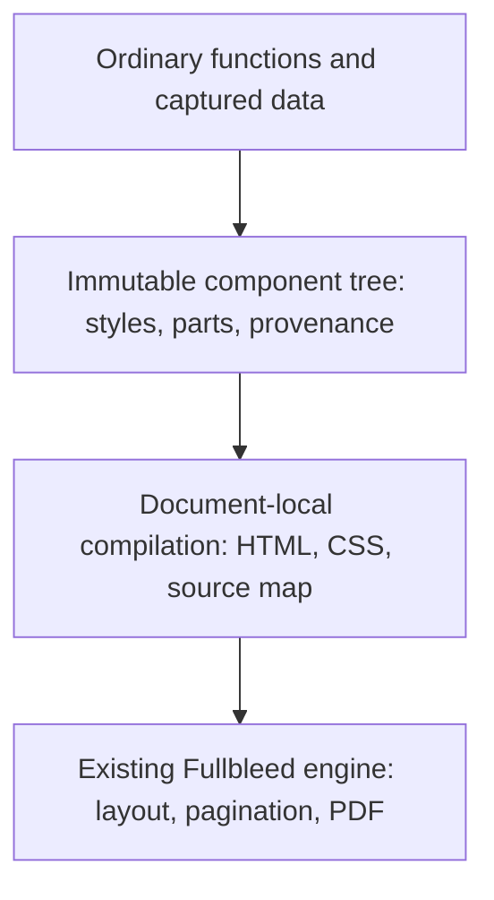

# Component authoring: implementation review

Status: working proposal with a source-branch Python prototype, 2026-10-15. This is not
the published API or a promise of cross-language parity. The stable authoring
guide remains [component-authoring.md](component-authoring.md).

## Assessment

The current API is a useful safe serializer and composition layer, but it leaves
most design work at the HTML/CSS level. Renaming `div` to `Box` removes markup
syntax; it does not remove stylesheet coordination, duplicate table definitions,
or pagination decisions. More tag wrappers will not address that limitation.

The useful unit of reuse should be **content, appearance, and print behavior
together**. An author should be able to import a `CustomerDetails` component,
place it in another document, and customize its advertised parts without finding
its stylesheet or understanding its internal markup.

The source review found these concrete causes:

| Current implementation | Authoring consequence | Recommended change |
| --- | --- | --- |
| [`component`](../python/fullbleed/ui/core.py) only marks a function | Component identity disappears during serialization; diagnostics cannot reliably identify the authored component | Retain component boundaries and source locations through compilation |
| Most [`primitives`](../python/fullbleed/ui/primitives.py) return an HTML element with forwarded props | Authors still manage attributes, declarations, and nested table tags | Keep primitives, but add abstractions that remove repeated decisions |
| [`StyleSheet`](../python/fullbleed/ui/stylesheet.py) is attached separately to the document | Importing a component does not import its appearance; class strings and selectors must agree | Carry immutable style values on nodes and collect them automatically |
| Custom components manually forward `style` and `class_name` | Root customization is repeated boilerplate; descendant selectors couple callers to markup | Provide immutable root overrides and explicitly named parts |
| `DocumentArtifact` stores `page`/`margin`, while rendering gets geometry from CSS or engine settings | An apparently meaningful document option can fail to change the PDF | Give real page geometry one owner and reject conflicting settings |
| `Element` and artifact values remain mutable | Shared objects can change later output | Snapshot authoring inputs; return copies for overrides |
| Tables expose `THead`, `Tr`, `Th`, and `Td` separately | Column labels, widths, alignment, and cell formatting are maintained in multiple places | Define a column once and let `DataTable` own the resulting structure |

The existing escaping, ordinary Python functions, explicit renderer/font choice,
semantic elements, and static output model are good foundations. Preserve them.

## The prototype also needs an ergonomics pass

The experimental implementation fixes important ownership problems, but that
does not by itself make it easy to learn. Its first example previously introduced
`styled`, theme tokens, declared parts and overrides while teaching a two-line
field. Those are useful library-author tools; they should not be prerequisites
for writing a document. The guide now starts with an ordinary function, a layout
and a local style, then adds reusable styling and customization as separate steps.

There are two authoring jobs:

- **Writing a document:** compose an imported kit, supply records, choose the
  theme and paper, and render. `Field`, `WorkTable` and `Total` in the example kit
  have application meaning. Their consumers should not need internal selectors,
  table tags or font setup in each component.
- **Building the kit:** define structure, typography, defaults, variants and any
  public customization points. This still requires design decisions. Moving those
  decisions into a function is valuable when other documents can reuse it without
  repeating them; hiding a one-off HTML tree behind a new name proves little.

This distinction should guide both API design and documentation. The kit remains
ordinary application code, not a required framework or a built-in invoice model.
Renderer/font setup belongs once at the application boundary. Business functions
can do arbitrary Python work; immutability snapshots their output, it does not
make an impure callback deterministic.

| Remaining cost in the prototype | Recommendation |
| --- | --- |
| Several spellings for a style change (`style=`, `styled`, `.with_style`, `.with_parts`) | Teach `.with_style(...)` for one instance, `styled(...)` for repeated defaults, and parts only when customizing another component's advertised internals. Preserve `style=` for composing existing style values. |
| `style=style(...)` adds visual noise in deeply nested calls | Prefer a reusable styled primitive or a normal call followed by `.with_style(...)` in teaching examples. Do not inject arbitrary style keywords into every business function. |
| `Flow` and `Stack` both sound like vertical layout | Teach `Flow` for a flowing document body and `Stack` for a local flex group. Their different pagination behavior must remain visible; do not silently alias them. |
| Tokens and public parts are strings checked at runtime | Show them as explicit contracts and surface their available names in tools. Do not imply editor completion is complete. |
| Page size, fonts, theme text and rendering appear together in starter code | Give page geometry to the document and font/renderer configuration to the application. A future convenience preset must select a bundled font explicitly, without depending on system fonts. |
| Layout failures can still describe an entire table | Keep source scopes, but improve the failing row/cell location. Authors should not have to inspect generated HTML to diagnose ordinary document mistakes. |

Keep explicit physical units. Saving the characters in `pt(12)` is a poor trade
if it makes a print measurement ambiguous. A small checked style vocabulary is
useful editor support; it should not become a second CSS engine or a promise that
every syntactically accepted declaration has identical layout behavior.

## Composition contracts to settle before adding more API

Initial installed-candidate probes found three places where the prototype asked
authors to know its implementation. Fragment and spacing behavior remain open.
The current candidate addresses argument forwarding with separate style layers;
that improvement does not make the whole design ready to stabilize.

| Operation | Observed behavior | Recommended contract |
| --- | --- | --- |
| Move a fragment-returning component later in a `Flow` | It works as the first child, but fails later with a root-styling error because spacing is applied through `with_style` | Moving a valid child must not change whether it is accepted. Define transparent fragment expansion at the flow boundary while retaining component provenance. Until that exists, reject the unsupported shape consistently. |
| Place a child with `margin_top=pt(24)` into `Flow(..., gap=pt(8))` | The placed copy has an 8 pt top margin; the original node stays unchanged | Parent spacing and child styling need separate ownership. Specify whether gap and margin combine, collapse or conflict; do not implement that decision as an undocumented style replacement. Check the behavior at page boundaries too. |
| Apply `styled` to a function with a required business argument named `style` | The initial wrapper consumed the argument and called the function without it; the current candidate forwards it unchanged | Preserve business arguments. Use per-instance appearance overrides on the returned node rather than injecting a new argument into arbitrary call signatures. |

The position-dependent case is small enough to expose the problem directly:

```python
@component
def Notes():
    return Fragment(Paragraph("First note"), Paragraph("Second note"))

Flow(Notes(), Paragraph("After"))   # Currently accepted.
Flow(Paragraph("Before"), Notes())  # Currently raises a root-styling error.
```

Transparent composition and styling a root are separate contracts. A fragment
can contribute siblings without having a single root to style. Do not introduce
an implicit container just to make the second call work: that can change layout,
semantics and pagination. A future implementation needs to carry diagnostic
boundaries independently of the emitted element structure.

`styled` cannot both transparently forward arbitrary function arguments and
unconditionally reserve `style` for itself. The current candidate preserves
arguments and teaches `StyledField(...).with_style(...)` for an explicit instance
override. It retains default declarations separately from explicit node styles:
primitive defaults come first, followed by styled defaults from inner to outer,
then explicit styles authored by the function or supplied to its primitive.
Finally, `.with_style(...)` overrides the result. A recipe supplies defaults; it
does not defeat an explicit appearance chosen inside a custom component.

This keeps `styled(Paragraph, ...)` compatible with the primitive's existing
`style=` argument, while allowing a custom function's `style` to mean ordinary
business data. A function without that argument no longer gains it implicitly.
Such callers use `.with_style(...)` after the call. This changes the experimental
shortcut, not established `fullbleed.ui` imports. The node's `style` stores authored
declarations; compilation and the legacy adapter combine those with defaults.

Before stabilizing, retain executable cases for moving a component among sibling
positions, empty and multi-root returns, reusing a child under different parents,
and a wrapped function with a `style` argument. Check accepted structure and
actual pagination where layout is involved. These composition rules matter more
than another shorthand or tag alias.

## Judge the API by edits, not by shorter markup

The existing and candidate invoice examples are different designs, so their line
counts are not a controlled ergonomics comparison. The useful comparison is the
number of decisions an author must coordinate for a specific change:

| Author task | Established surface | Experimental direction and current limit |
| --- | --- | --- |
| Reuse a field in a report | Import its function and attach the relevant selector rules to the new document | Import the styled function; provide its documented theme values. The shared invoice/report kit demonstrates this. |
| Change one component's background | Its function must accept and forward a styling prop to a chosen root | Call `.with_style(background=...)` on the result. A fragment still needs an explicit root. |
| Restyle a label inside a third-party component | Learn its classes and selector structure | Use a documented `label` part. Internal structure may change while that contract remains; automatic part-name completion is unfinished. |
| Add a formatted table column | Coordinate the header, each row's cell and column styling | Add one `Column` containing label, callback, width and alignment. Calculations and formatting stay in application code. |
| Change paper size | Ensure the effective CSS or engine setting changes, rather than only decorator metadata | Change `Page`; verify the resulting PDF's page box. The installed-wheel examples do this. |
| Diagnose content that cannot paginate | Interpret native layout output and the generated document | Resolve the trace to the authored component scope. Identifying the exact failing descendant remains open. |

Automated examples establish these behaviors for their fixtures. They do not
establish that an independent author finds the API easier. Before stabilization,
give authors the same five tasks: reuse a field, rebrand the document, add a
column, switch paper size, and fix an overflowing component. Record where they
need undocumented knowledge, how many places they edit, and whether they reach
for generated HTML. Repeat after revising the API. Do not turn this into an
unmeasured productivity claim.

## The intended authoring model

Use ordinary function arguments for business meaning and children for composition.
Use style values for appearance, theme tokens for document-wide choices, and
named parts for intentionally exposed internals. These have different jobs.

The [executable prototype guide](../examples/component_recipes/README.md) uses:

```python
Label = styled(Paragraph, font_size=pt(8), color=token("muted"))

@component(parts=("label", "value"))
def Field(label: str, value: str):
    return Stack(
        Label(label, part="label"),
        Paragraph(value, part="value"),
        gap=pt(4),
    )

customer = Field("Prepared for", "Maple & Finch")
highlighted = customer.with_style(background="#f2f5f8", padding=pt(12))
highlighted = highlighted.with_parts(label=style(font_weight=700))
document = Document(highlighted, theme=Theme({"muted": "#667580"}))
```

This earns its extra API surface only if the component can move between modules
and document families without additional wiring. The prototype's invoice and
operations report share [one kit](../examples/component_recipes/kit.py) to test
that property. A single isolated example would not establish it.

`class_name` should keep its literal CSS meaning. It should never look up a Python
variable, import a stylesheet, or silently change scope. Make it an escape hatch
for authors choosing selector-based CSS. The primary component workflow should
not require class names. Existing selector-based documents remain supported.

Style precedence must be teachable: primitive defaults, reusable styled defaults,
call-site style, then explicit overrides. Preserve declaration order for CSS
shorthand/longhand interactions. Resolve theme tokens per document; a theme
supplies values rather than silently defeating local component choices.

Parts need an actual boundary rule. In the prototype, root delegation preserves
the delegated component's exposed parts, while a nested component starts a new
boundary. An unknown part name is an error. Decorating a function establishes this
identity; an ordinary function still composes but introduces no boundary.
Fragment components have no implicit styling root and require a real container
when root styling is requested.

The initial prototype discovered parts from the constructed tree, so an empty
table had no `cell` part to customize. It now supports `@component(parts=(...))`
to declare a contract independently of current content. A declared optional part
accepts an override even when absent; an undeclared name still raises a useful
error. Authored markers are checked against the declaration. The factory and
instance expose the names for tools, and the decorator preserves argument types.
Automatic part-name completion still needs work. Callers should not branch on row
count just to apply a reusable style.

Ordinary conditionals should handle variants initially: `paid=True` or
`tone="warning"` is a function argument. A variant registry, implicit prop
injection, class metaprogramming, or a second expression language would add
concepts before their benefit is demonstrated.

React's useful precedent here is functions, props, children, and immutable input
snapshots. Fullbleed does not need a reactive lifecycle to produce a static PDF.
[React's props and composition guide](https://react.dev/learn/passing-props-to-a-component)
also cautions against habitual prop forwarding. React-pdf's
[style values and composition](https://react-pdf.org/docs/v4/styling) provide a
useful comparison for a styling workflow that does not require selector wiring.
These are design references, not compatibility targets.

## Architecture and ownership



1. **Authoring owns intent.** Nodes retain content, styles, semantics, and source
   identity. Capture iterables once; reject accidental mappings, uncalled
   functions, and non-finite values. Keep rendering and asset I/O out of imports.
2. **Compilation owns translation.** Resolve tokens, compose styles, deduplicate
   declarations, generate deterministic class names, and attach engine source
   IDs. Keep the registry document-local so import/render order cannot change
   output. Preserve source filenames in a sidecar rather than embedding local
   paths in delivered PDFs.
3. **The engine owns layout.** Components should not estimate text metrics or
   split rows in Python. Native pagination must retain all content, make progress,
   and explain an impossible constraint through structured diagnostics.
4. **The document owns delivery settings.** Page size, margins, title, and language
   belong to the document. Renderer configuration owns fonts, assets, profiles,
   and diagnostics. Validate conflicts. Rendering multiple documents must not
   leak metadata or mutable configuration between them.

The prototype implements these boundaries with frozen Python values, generated
classes, native `data-fb-id` attributes, and a source map. It creates a fresh engine
per render and runs a pagination trace before returning output. That policy is
deliberately simple but incurs another layout pass; it is not a qualified
performance design. A later render-result API should expose PDF bytes, diagnostics,
and source associations from the same native layout operation. Engine reuse needs
an explicit isolation contract and measurements before it becomes the default.
Native source collection currently runs on every pagination attempt; its cost
also needs qualification for large authored and unmarked documents.

## Where the API should add real value

`DataTable` should own headers, column alignment/widths, row iteration, empty
states, and header repetition. Cell callbacks can return components. Applications
still own calculations and locale-sensitive formatting. A new amount column
should require one declaration, not parallel edits to a header and every row.

Print-aware primitives should follow: flowing blocks with spacing, headings kept
with following content, explicit breaks, page regions, and repeated headers or
footers. Distinguish ordinary content `<Header>` from a repeated page header in
names and documentation. `Flow` is normal block flow; `Stack` is flex layout.
Changing between them can change pagination, so they are not synonyms.
React-pdf's [page-wrapping API](https://react-pdf.org/docs/v4/advanced/page-wrapping)
is a useful example of exposing these print decisions directly.

Do not build a large invoice/business-component catalog into the core yet.
Use realistic example kits to establish reusable contracts, then promote only
patterns that recur. Financial rules, branding, and commerce automation belong
outside the primitive authoring layer.

Diagnostics are part of ergonomics. The desired error is
`Invoice → WorkTable → row 17 → Amount`, with the authored source and actionable
reason. The prototype retains that path for authoring errors and table callbacks.
Native pagination events now retain the authored roots associated with each
layout fragment. Anonymous containers forward those roots, and splits retain
only the roots belonging to each fragment. The experimental `LayoutError`
resolves those IDs through the document's source map and exposes page, component
paths, and definition locations. A failing table can identify `DataTable → table`.
This is scope attribution, not a claim that the engine has identified the failing
row or cell. Multiple roots remain separate; unknown IDs do not cause a guessed
selector match. Other native diagnostics and descendant-level failure locations
still need work.

## Findings from the prototype

Actual installed-wheel rendering uncovered gaps that serialization tests missed:

- A repeated table header could split without consuming a body row, creating an
  unbounded sequence of header-only pages. A native progress guard now stops
  that cycle. The candidate also continues top-aligned oversized cells through
  their logical content splitters, retaining column widths and repeated headers.
  A short companion cell finishes independently instead of repeating on every
  page. An explicit fresh-page signal lets ordinary rows move intact first.
  Tables containing rowspans, page-tall images inside cells, and oversized
  non-top-aligned cells remain outside this implementation. The engine's
  permissive overflow fallback still exists;
  the experimental renderer detects its trace event and raises
  `layout.unsplittable` instead of returning that PDF. This check is not a general
  overflow validator. Varying page widths, complex cell decorations, and semantic
  associations across continued cells still need dedicated qualification.
- Changing a literal `thead` to `display: table-row-group` does not disable
  repetition in the current native parser. The prototype emits scoped `th`
  cells in the first body row when `repeat_header=False`.
- Page geometry and PDF metadata need rendered-output checks, not assertions
  about generated HTML. The fixtures check actual PDF page boxes, title, and
  language, including a custom physical page size.

These are reasons to keep this API experimental. A styled wrapper cannot promise
pagination behavior that the renderer has not demonstrated.

## What remains before stabilization

| Work | Acceptance condition |
| --- | --- |
| Composition and spacing | Child acceptance is independent of sibling position; fragments retain provenance; parent spacing has an explicit relationship to child margins; generic wrappers preserve business arguments |
| Oversized-row continuation (partial implementation) | Extend the tested top-aligned text cell behavior to rowspans, page-tall cell images, and other vertical alignments; qualify changing page geometry, complex decorations, and semantic continuity; unsupported cases fail explicitly |
| Native diagnostics (partial implementation) | Unsplittable fragments resolve to authored root scopes; identify failing descendants and map missing glyphs/other layout diagnostics before claiming full component-level attribution |
| Typing and completion (partial implementation) | Generated stubs and installed mypy/Pyright checks cover styles, primitive props, layout choices, page options, record types and component arguments; token/part-name completion remains open |
| Declared parts (implemented in the prototype) | Empty/conditional states accept documented parts; boundaries, root delegation, schema validation, and callable argument types have focused coverage; author feedback remains needed |
| Semantics and accessibility | Reuse the existing semantic validation contract; test generated structure and final delivery profiles separately |
| Rendering reuse | Measure authoring, compilation, layout, and output costs independently; verify metadata/configuration isolation |
| Migration (incremental bridge implemented) | `to_legacy` embeds new styled nodes in existing documents; whole-document migration still needs an explicit page/theme/renderer audit and a decision on the stable namespace |
| Author usability | Independent authors can rebrand a document, reuse a component, add a table column, change page size, and diagnose a failure without editing generated HTML or learning internal selectors |

The candidate now ships generated stubs backed by the same style-property,
primitive and layout vocabulary as runtime validation. Installed consumer checks
use mypy and Pyright; actual Pyright language-server requests verify completion
items rather than inferring editor behavior from annotations. The generation
check prevents edits to the runtime vocabulary from leaving stale packaged stubs.
The prototype's small checked vocabulary is not a CSS capability declaration.

Typing has a real boundary around `styled`: Python's parameter specifications
cannot generally add arbitrary keyword parameters to an existing signature
([PEP 612](https://peps.python.org/pep-0612/#concatenating-keyword-parameters)).
The candidate now preserves the wrapped signature exactly and removes the
permissive fallback previously needed for an injected `style=` keyword. A business
argument named `style` retains its own type; a primitive's declaration-valued
`style` remains checked alongside its other arguments. Runtime validation still
handles token and part names, finite values, explicit units (including shorthand
tuples), and CSS syntax. Recursive iterable constraints also need runtime checks:
the installed Pyright consumer rejects unwrapped `Flow` text, while mypy accepts
that recursive case. Do not confuse editor assistance with complete static
validation.

Keep the first implementation in `fullbleed.ui.experimental`. Stabilize its
contracts using the invoice, report, adversarial pagination cases, and actual
author feedback. Then carry semantics to JavaScript/TypeScript and C#: JSX or
idiomatic builders should construct equivalent authoring values, not require
copying Python syntax. The existing .NET element API already demonstrates
immutable `WithStyle` customization; keep useful behavior that a binding has
instead of restarting it to match Python names. Keep rendering in the existing engine and optional
language/framework integrations outside the core dependency set.

The migration direction matters. `to_legacy(node, theme=...)` lets an existing
`DocumentArtifact` use one new component while retaining the old document's CSS,
fonts, geometry, metadata and renderer. It snapshots new component values to
legacy elements, resolves tokens and emits their styles inline. Fragments remain
siblings; no HTML parser, extra wrapper, generated source IDs or global style
registry is involved. The legacy cascade still applies, and the document owns
base text styles. Missing tokens keep the same component paths as compilation.

Converting an old document automatically would require deciding how its external
selectors, inline priority and previously informational page settings interact
with the new document's ownership rules. The bridge leaves that audit explicit.
It also does not promise experimental renderer checks or source maps when the
application continues to use the old renderer. This supports gradual adoption
without declaring the old imports deprecated or committing to two permanent APIs.

The next useful milestone is a reusable design kit whose authors can confidently
change real documents. A larger number of element wrappers is not that milestone.

## Implementation order and language expansion

1. **Keep the Python experiment small enough to evaluate.** The immutable tree,
   component-owned styles, explicit overrides, table columns and page ownership
   are implemented in the draft. Use the shared kit and editing tasks above to
   decide which concepts deserve stable names. Keep the established API working
   through the explicit adapter during that evaluation. Settle fragment, spacing
   and wrapper-argument contracts before adding more authoring helpers.
2. **Close the print and diagnostic contracts.** Extend continuation deliberately,
   retain semantic structure, and improve descendant attribution. Document
   unsupported content instead of making a component promise stronger than its
   engine. Correct HTML serialization alone is insufficient evidence.
3. **Make the common path pleasant in an editor and at runtime.** Finish token/part
   discoverability and measure compilation, source collection and the extra
   preflight layout pass. Prefer a native result containing output and diagnostics
   from one layout operation before committing to a stable rendering interface.
4. **Stabilize semantics, then adapt syntax to each language.** Specify style
   precedence, children, units, theme resolution, part boundaries and error paths
   with shared fixtures. JavaScript/TypeScript can use functions and JSX; C# can
   keep idiomatic immutable builders. Compare authored intent and rendered output,
   rather than requiring identical generated class names or Python-like syntax.

A new variant registry, hooks, reactive state, implicit global theme context, or
more tag aliases does not currently remove a demonstrated authoring problem.
The immediate design work is reducing the concepts needed for a common edit and
making print behavior trustworthy. Cross-language expansion should carry those
settled contracts, rather than freezing this prototype's accidental complexity.
