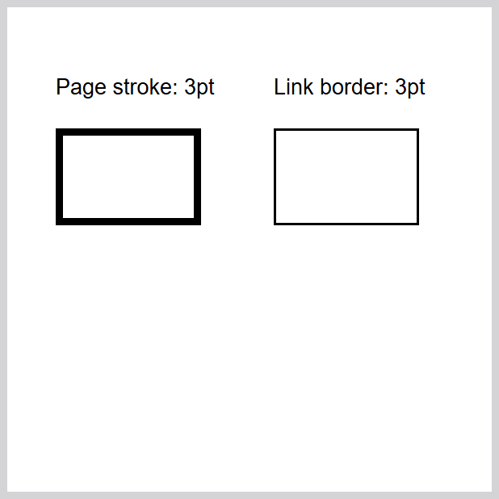

# Reproduce PDF link-reader observations

This optional developer check separates four observations: analytic CSS shapes,
the final PDF's `QuadPoints`, independently rendered paint, and reader hit tests.
It is not part of `pip install fullbleed` and adds no runtime dependency.

Use a candidate wheel that includes [PR #125](https://github.com/fullbleed-engine/fullbleed-official/pull/125).
Published `2.6.0a13` does not contain this navigation implementation. The input
manifest records the installed native module's SHA-256 because the local QA
wheel reused that version number.

## Render with the candidate

Run from the repository root in the Python environment containing that wheel:

```sh
python tools/pdf_link_readers/render_cases.py --out target/pdf-link-inputs
```

This writes four HTML/CSS inputs, PDFs, native previews, and `inputs.json`. The
output directory must not already exist. No network access is needed to render.

## Observe independent readers

The reader environment can be separate from the engine environment. The
recorded run used CPython 3.11 and the package versions pinned here:

```sh
python -m pip install -r tools/pdf_link_readers/requirements.txt
npm install --ignore-scripts --no-save --prefix target/pdf-link-reader-deps pdfjs-dist@6.4.299
python -m playwright install --no-remove chromium
python tools/pdf_link_readers/check.py --inputs target/pdf-link-inputs --pdfjs target/pdf-link-reader-deps/node_modules/pdfjs-dist --out target/pdf-link-reader-results
```

Use `--chromium /path/to/chrome` to select an existing Chromium executable.
[Playwright 1.63](https://playwright.dev/python/docs/release-notes#version-163)
supplies Chromium 153.0.8010.12, the browser used for the recorded observations.
Older Chromium 133 cannot load these PDF.js specimens. A different browser
version is recorded as a new observation. Every PDF.js asset used by the harness is checked
against `pdfjs-lock.json`, which also identifies the upstream archive and source
revision. Install the dependencies before running; the check itself only serves
local fixture files on a temporary loopback port and blocks external requests.
Clicks are intercepted before they can follow the synthetic `example.invalid`
links. It opens a fresh headless browser and closes it after the run.

Exit codes:

- **0:** every sampled geometry, paint, and reader observation agrees.
- **2:** observations completed, with mismatches retained in `report.json`.
- **1:** invalid inputs, missing annotations, or an incomplete reader run.

The measured candidate returns **2** because the sloped-link reader differences
are still present. There is no expected-failure list or option to turn those
differences into a passing result. Results are reported independently for each
reader and each shape. Source PDFs, screenshots, individual point observations,
actual click checks, input hashes, runtime identity, reader versions, and the
verification harness are retained in the new output directory.

## Interpret the result

The four specimens occupy a 200pt square page. The base link is a 100pt square
at CSS `(40pt, 40pt)` with a blue background. Variants rotate a 100pt by 40pt
rectangle by 30 degrees, clip a right triangle, or clip a 40pt-radius circle.
The independent oracle derives these shapes analytically from their dimensions.
It does not use Fullbleed's region code or treat reader output as ground truth.

The grid samples every 5pt, excluding points within 1.5pt of the intended
boundary. Paint is sampled from a PDFium render at 144dpi; these specimens have
no decoration outside the link. PDFium observations use `FPDFLink_GetLinkAtPoint`.
PDF.js observations use its parser, canvas, official annotation layer, and
browser hit testing. Selected interior, exterior, and mismatching points also
receive actual mouse clicks. No custom shape filter is added to either reader.

The [document guide](../../docs/pdf-links.md#reader-behavior) records the initial
results and their limits. The compact [recorded observation](observations/e7ae956.json)
includes runtime and reader identity, the per-case mismatch counts and click
observations, and hashes of the complete retained artifacts. A complete run can expose reader differences even when
the encoded geometry and painted shape agree. Treat those as unresolved
compatibility observations, not as a passed conformance or accessibility gate.

## Check borders on cropped imported links

An independent import fixture checks a different failure: a reader can draw an
extra border along a newly clipped `Rect`, even when the appearance stream
already contains the correctly clipped artwork. Generate these inputs with the
candidate wheel, then use the same separate reader environment and PDF.js
assets described above. The generation environment also needs `pypdf`; it is
an optional fixture-authoring dependency, not a Fullbleed runtime dependency:

```sh
python -m pip install pypdf==6.1.1
python tools/pdf_link_readers/imported_borders.py generate --out target/imported-border-inputs
python tools/pdf_link_readers/imported_borders.py check --inputs target/imported-border-inputs --pdfjs target/pdf-link-reader-deps/node_modules/pdfjs-dist --out target/imported-border-results
```

The generator uses pypdf to author eight white-page source PDFs independently
of Fullbleed: solid, dashed, rounded, beveled, inset, underline, outline
highlighting, and an explicit appearance stream. Fullbleed composes and stamps
each source with an offset. The resulting 24 PDFs are checked in PDFium and
the actual PDF.js annotation layer.

A narrow band at the cut edge must remain white. Output artwork must still be
visible, interior clicks must retain their target, and the clipped-away area
must be inactive. The explicit source appearance supplies a positive paint
control; a reader that omits a border-only source is not evidence of its
preservation. Screenshots, PDFs, hashes, reader versions, and the harness are
retained. Exit **2** records an unwanted edge; exit **1** means an incomplete or
invalid check; exit **0** means these bounded observations pass.

This check does not establish full border-style parity. It verifies that the
stored `H` value survives, but does not qualify mouse-highlight appearance,
keyboard navigation, or accessibility.

The [recorded observation](observations/imported-border-cut.json) includes the
before/after counts, native-module identity, source hashes, and a separate
Poppler reference check. The public alpha version number alone does not
identify the candidate used for these observations.

## Check table text positions

The [table observation](observations/table-text-baselines.json) records controls
for plain text, neutral spans, and neutral links. They cover page breaks,
preserved line feeds, tall cells, vertical alignment, and both border models.
The public-API regressions use PDFium to measure glyph origins after direct,
compiled, and compact reflow rendering:

```sh
FULLBLEED_TEST_INSTALLED_NATIVE=1 python -m pytest tests/test_fullbleed_links.py -k 'standard_font_wrapping_is_unchanged or neutral_table_wrappers_preserve_cell_alignment'
```

Install the candidate wheel and the repository's test requirements first. The
environment flag selects the installed native module instead of an older local
build. These checks compare line/page breaks and baselines to within 0.001pt;
the tall-cell controls also compare horizontal origins. Fractional-size Base-14
text retains small horizontal rounding differences recorded in the observation.
These checks do not establish identical rasterization in every PDF reader.
The observation retains the corresponding native checks and known pixel
differences for the sampled fonts.

The [middle-alignment observation](observations/table-middle-baselines.json)
compares 216 plain/span/link controls and two exact upstream fixtures with
Chromium's printed baselines. It covers two registered fonts, three line
heights, tight and tall cells, both border models, and normal/nowrap text.
Removing an extra cell paint offset corrects a 0.5pt downward shift in 158
cases; all 218 then match the measured vertical origins within 0.001pt.
The retained record includes parameters, font hashes, reader identity, PDF
hashes, and each comparison. The bundled-font regression is reproducible with:

```sh
cargo test --lib pdf_links_middle_table_cells_use_the_line_box_without_extra_paint_offset
```

This measures these baseline positions, not general browser or raster parity.
The unchanged external CSS corpus remains a separate release check.

The [odd and fractional dimension follow-up](observations/table-middle-fractional-baselines.json)
adds 208 measurements, including four multipage upstream fixtures. Registered
font extents round to the nearest CSS pixel, half-leading rounds down, and
middle alignment rounds the final baseline after positioning the line box.
These cases cover 14px and 16px fonts, odd and fractional line/cell heights,
fractional cell origins, and plain/span/link variants. All measured vertical
origins match Chromium within 0.001pt; the earlier 218 PDFs remain byte-identical.

The separate 99-fixture table audit injects the pinned upstream UA stylesheet
before authored rules. Its previous-wheel control reproduces all 99 CI PDFs
byte for byte. With the correction, 91 remain identical and eight have smaller
vertical-origin error, including the four multipage regressions. Text and page
assignments are unchanged. The initial local attempt omitted that stylesheet
and is explicitly excluded from the evidence. The new native regression is:

```sh
cargo test --lib pdf_links_middle_table_cells_snap_absolute_baselines_with_odd_dimensions
```

This focused audit does not replace the unchanged full-corpus CI comparison.

## Inspect a source link border at different zoom levels

The [independent source PDF](fixtures/border-zoom.pdf) contains two frames with
3pt borders. The left frame is page artwork. The right is a Link annotation
with `/BS << /W 3 /S /S >>`, no appearance stream, and no `NoZoom` flag.
The standard-library generator reproduces the checked-in PDF exactly:

```sh
python tools/pdf_link_readers/make_border_zoom.py --out border-zoom.pdf
```

Open it with the file picker in the [official PDF.js demo](https://mozilla.github.io/pdf.js/web/viewer.html)
and change the zoom from 75% to 150% and 300%. In the observed demo version
6.5.316, the right border stays at 3 CSS pixels while its frame grows. The
unmodified official 6.4.299 release also keeps the link border at 3 pixels at
75%, 150%, and 225%; the page stroke grows to 3, 6, and 9 pixels respectively.



The [recorded measurements](observations/pdfjs-border-zoom.json) include reader
versions, the official release archive hash, source-PDF hash, computed CSS,
and screenshot measurements. The PDF reference defines border width in points
and describes the `NoZoom` exception in
[sections 8.4.2 and 8.4.3](https://opensource.adobe.com/dc-acrobat-sdk-docs/pdfstandards/pdfreference1.6.pdf#page=596).

This isolates one source-reader difference without using Fullbleed. It does
not establish preservation of every imported border style, or make the
composition checks above pass. Keep source-reader observations separate from
Fullbleed output comparisons.
